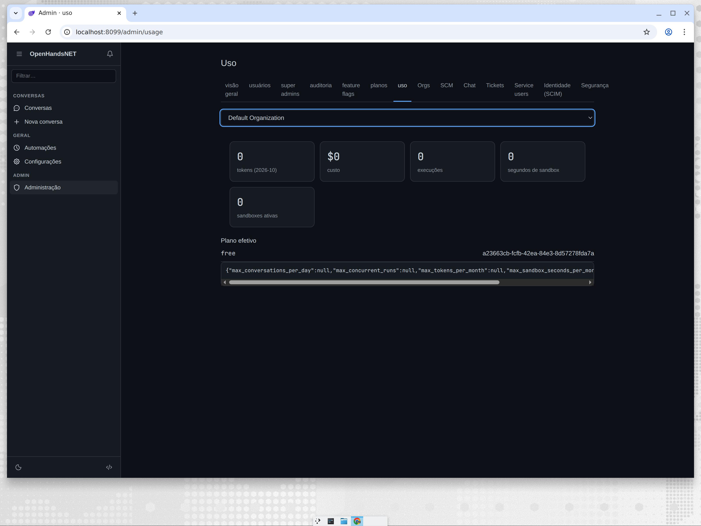
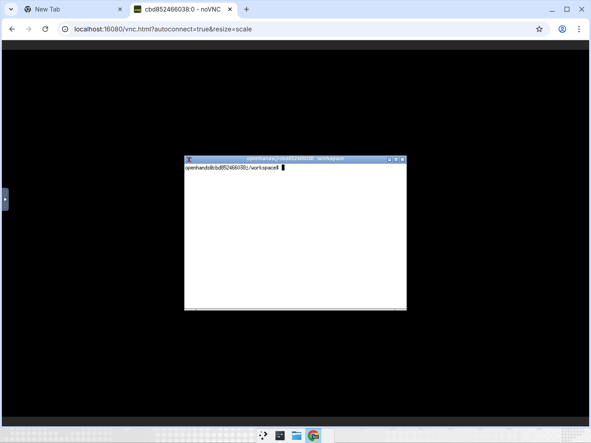

# OpenHandsNET

[](https://github.com/afonsoft/OpenHandsNET/actions/workflows/ci.yml)
[](https://sonarcloud.io/summary/overall?id=afonsoft_OpenHandsNET&branch=main)
[](https://sonarcloud.io/summary/overall?id=afonsoft_OpenHandsNET&branch=main)
[](https://sonarcloud.io/summary/overall?id=afonsoft_OpenHandsNET&branch=main)
[](https://sonarcloud.io/summary/overall?id=afonsoft_OpenHandsNET&branch=main)
[](https://sonarcloud.io/summary/overall?id=afonsoft_OpenHandsNET&branch=main)

Port open-source (MIT) do ecossistema **OpenHands** para **.NET 10 / C# 14 /
Blazor WebAssembly** — agente autônomo de engenharia de software com conceitos
Cloud + Enterprise e UX inspirada no Devin Web, sobre a base de
[`afonsoft/open-webui`](https://github.com/afonsoft/open-webui).

**AI-Driven Development (ADD)**: este projeto é desenvolvido por agentes —
o processo é *agent-first* (issues, SPECs, implementação, testes, PRs).
As SPECs seguem SDD (Spec-Driven Development) como artefato-fonte de
verdade consumido e executado por agentes: SPECs escritas para agentes,
executadas por agentes, revisadas por humanos.

> Status: **produto funcional** — SPECs 01–64 + 68/69 entregues e
> arquivadas em [`docs/specs/`](docs/specs/) (agente, sandbox, API, UI
> completa, enterprise ops, integrações SCM/ChatOps/ticketing,
> identidade enterprise, edge security, indexing/insights/knowledge e
> browser profiles). SPECs ativas em [`.specs/`](.specs/).
> Quality gates: `dotnet format` + testes em CI; análise SonarCloud
> (badges acima) — ver `ci.yml`.
> English: [README.en.md](README.en.md).

## Visão

- **EventStream V1** no núcleo (`kind` discriminador, ULID, `parent_id`) —
  toda ação/observação do agente é um evento persistido e transmitido.
- **Sandbox por conversa** (Docker.DotNet / Kubernetes): workspace isolado,
  bash session, browser Playwright, file/git ops, sleep/wake, warm pool.
- **API `/api/v1` compatível com OpenHands V1** + realtime via SignalR
  (deltas efêmeros + durable events).
- **UI Devin-like** (Blazor WASM): chat streaming com reasoning, composer
  rico (@menções, /slash, uploads, drafts), IDE workbench (Monaco + SCM +
  busca), checkpoints com revert, attention inbox, i18n em 8 locales,
  tab **Desktop** com noVNC ao vivo do sandbox (SPEC-113).
- **Enterprise open-source**: OIDC + API keys `sk-*`, orgs/RBAC,
  multi-tenancy, planos/quotas/billing, auditoria, egress allowlist,
  security analyzer, secrets by-reference, S3 artifacts.
- **Automação**: routines agendadas (interval/daily/weekly/once) + webhook
  triggers anônimos rate-limited + tool `routine` para o agente.
- **CLI** `openhandsnet`: login device-flow, `run` headless, `serve`,
  `doctor --preflight`, `eval`, TUI.

## Comparação

| Área | OpenHands (OSS) | OpenHands Cloud/Ent | **OpenHandsNET** | Devin Web |
|---|---|---|---|---|
| Licença | MIT | Polyform (fechado) | **MIT** | Fechado (SaaS) |
| Stack | Python + React | Python + k8s | **.NET 10 + Blazor WASM** | Proprietária |
| Modelo de eventos | V1 `kind`/ULID | V1 + delta events | **V1 completo + `streaming_delta`** | Proprietário |
| Sandbox | Docker | k8s + Sysbox multi-host | **Docker em prod; engine k8s (SPEC-49)** | Proprietário |
| Warm pool / sleep-wake | Parcial | Sim | **Docker + k8s warm-pool (SPEC-49)** | Sim |
| Roteamento LLM | Config estática | LiteLLM proxy | **OmniRoute catalog + roles + BYOR LiteLLM (SPEC-50)** | Proprietário |
| Segurança | SecurityAnalyzer | IdP orgs + analyzer | **analyzer plugável + org policies (SPEC-48)** | Proprietário |
| Secrets | LookupSecret by-ref | Idem | **by-reference (`SecretNamesJson`)** | Vault interno |
| Memória | `.openhands/memory/` | Idem | **project + org scopes** | Knowledge/playbooks |
| Subagentes | task tool | Idem | **`task` + presets + depth cap** | Sim |
| Permissões | allow/deny/ask | Idem + org policy | **`allow/deny/ask` + plan mode + org policies (SPEC-48)** | Proprietário |
| Artefatos | workspace | S3/GCS filestore | **workspace + S3 provider** | Proprietário |
| Deploy | docker run/compose | Helm + KOTS/k0s | **compose + Helm chart (SPEC-49)** | SaaS apenas |
| Multi-réplica | — | Valkey/Redis backplane | **`IDistributedCache` + backplane SignalR** | Sim |
| UI | Agent Canvas (React) | Cloud UI | **Devin-like Blazor: chat, IDE, surfaces** | Referência de UX |
| Live desktop | — | VNC | **tab Desktop noVNC + surface proxy same-origin (SPEC-113)** | Live desktop |
| CLI | `openhands` TUI | cloud mode | **`openhandsnet` parity + eval + doctor** | `devin` API |
| i18n | en | en | **8 locales (pt-BR default)** | en |
| Automações | webhooks GitHub | schedules internas | **routines + hook triggers + `routine` tool** | Devin automations |
| API keys | — | `sk-*` + org binding | **`sk-*` + org binding + BYOR** | Sim |
| Eval | benchmarks OSS | — | **`openhandsnet eval` + asserts + llm_judge** | — |
| GitHub App | — | sim | **App + webhooks verificados + workspace PRs (SPEC-52)** | sim |
| SCM providers | — | GitHub | **GitHub + GitLab + Bitbucket + Azure DevOps (SPEC-53)** | GitHub+ |
| ChatOps | — | — | **Slack app: menção/slash → sessão, thread sync, auto-triage (SPEC-54)** | sim |
| Ticketing | — | — | **Linear + Jira triggers → start-task + write-back (SPEC-55)** | sim |
| Service users | — | — | **identidades `svc_*` com escopos + impersonation (SPEC-57)** | sim |
| IdP/SCIM | — | Keycloak | **SCIM 2.0 + grupos IdP→role/tier, qualquer IdP (SPEC-58)** | SSO |
| Edge security | — | — | **IP rules + input guard + rate limit por ator (SPEC-59)** | proprietário |
| Repo indexing | — | — | **index + Ask read-only (SPEC-60)** | codebase context |
| Session insights | — | — | **cost/latency/tool diagnostics (SPEC-61)** | sim |
| Knowledge | playbooks | playbooks | **suggestion queue + human review + groom (SPEC-63)** | knowledge |
| Browser profiles | — | — | **storage state criptografado + site cookies + TOTP (SPEC-64)** | sim |

Legenda: **negrito** = estado atual do OpenHandsNET; "em SPEC-N" = aprovado,
roadmap imediato.

## Quickstart

Pré-requisito: .NET SDK 10 (`dotnet --version`).

```bash
dotnet build OpenHandsNET.slnx          # build (9 projetos)
dotnet test OpenHandsNET.slnx           # testes
dotnet run --project src/OpenHandsNET.Api   # app em http://localhost:8080
cp .env.exemplo .env && docker compose up -d --build   # container em :3032
```

Configuração por env vars com prefixo `OPENHANDSNET_` (ex.:
`OPENHANDSNET_Database__Provider=PostgreSql`). Banco default: SQLite em
`data/openhandsnet.db` (migrado no boot). Endpoints: `GET /api/v1/health`,
`/api/v1/ready`, `/api/v1/config`.

Guias completos de instalação:
[Docker](docs/installation/docker.md) ·
[Host](docs/installation/host.md) ·
[Variáveis de ambiente](docs/installation/environment-variables.md)
(English: [docs/en/installation/](docs/en/installation/)).

## Screenshots

| Home | Configurações | Automações |
|---|---|---|
|  |  |  |

| Admin | Desktop ao vivo do sandbox (noVNC — SPEC-113) |
|---|---|
|  |  |

## Layout do repositório

```
.specs/             SPECs SDD/ADD (60+ módulos — comece por .specs/README.md)
migration-plan/     research (api-inventory, domains, risks) + roadmap
docs/               guias (deployment, ui, api, features) — índice em docs/README.md
docs/en/            documentação em inglês
charts/openhandsnet Helm chart (k8s — SPEC-49)
deploy/             manifests auxiliares (litellm, otelcol, prometheus)
src/                Domain · Application · Infrastructure · Api · Client (WASM)
                    · Sandboxing · RuntimeApi · SandboxAgent · Eval
cli/                OpenHandsNET.Cli (Spectre.Console — SPEC-06/31)
tests/              UnitTests · IntegrationTests · Client.Tests (bUnit)
                    · SandboxAgent.Tests
```

## Documentação

- **[docs/README.md](docs/README.md)** — índice completo (pt-BR).
- **[docs/en/](docs/en/README.md)** — English docs.
- Destaques: [installation](docs/installation/) ·
  [deployment/local](docs/deployment/local.md) ·
  [kubernetes](docs/deployment/kubernetes.md) ·
  [security](docs/deployment/security.md) ·
  [automations](docs/automations.md) · [cli](docs/cli.md) ·
  [eval](docs/eval.md) · [comparação detalhada](docs/comparison.md).

## Fontes

- Upstream MIT: `OpenHands/software-agent-sdk`, `OpenHands/OpenHands` (Canvas),
  `OpenHands/OpenHands-CLI`, `OpenHands/automation` (baselines em
  `docs/reference/upstream-baseline.md`).
- Upstream Polyform (conceitos apenas — **não portamos código**):
  `OpenHands/enterprise`, `OpenHands/OpenHands-Cloud`.

## Licença

MIT — implementação original. Marcas e conceitos de terceiros pertencem a seus
detentores.
