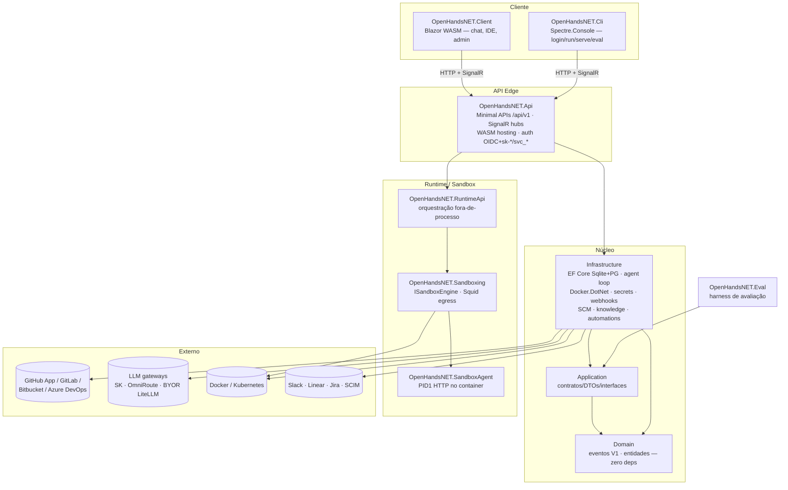

# Arquitetura — OpenHandsNET (overview)

Camadas e componentes. Fonte: `CLAUDE.md` estrutura do projeto +
`.specs/` ativas + `docs/specs/` (arquivo). Atualizado: 2026-10-19.

## Dependências (regra de camadas)

`Api → Infrastructure → Application → Domain` · `Client → Application` ·
`Cli` consome só contratos HTTP/SignalR · `RuntimeApi/Sandboxing/SandboxAgent`
formam o runtime separado (SPEC-35).

## Persistência e tempo real

- EF Core 10 — SQLite default, PostgreSQL enterprise (`Npgsql`), migrations
  duplas (`Migrations/` + `Migrations/Postgres/`), `DatabaseMigrator` no boot.
- SignalR — durable events + `streaming_delta` efêmeros; backplane
  Redis/Valkey para multi-réplica (SPEC-36).
- Cache/locks distribuídos: `IDistributedCache` + `ICoordinationBus`.

## ADRs

- [ADR-0001 — Estrutura do harness agente](0001-harness-structure.md)
