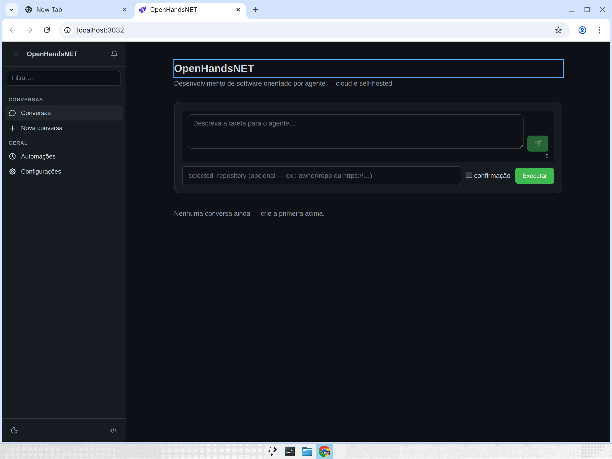
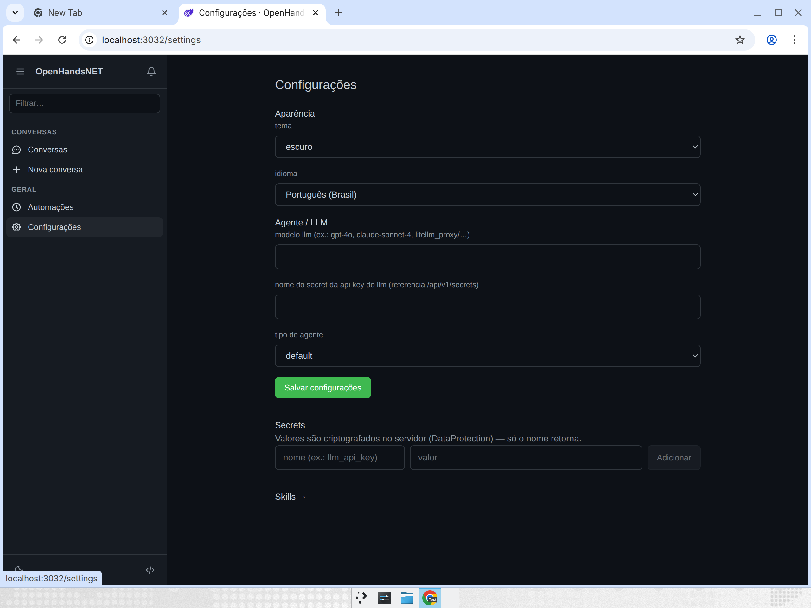
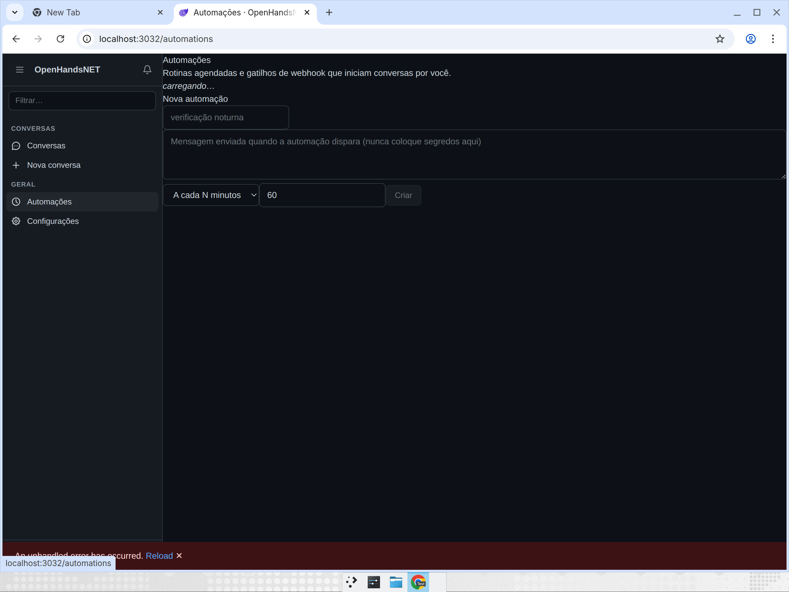

# Installation

OpenHandsNET install and configuration guides.
Português: [../../installation/](../../installation/).

| Guide | Contents |
|---|---|
| [docker.md](docker.md) | Docker / Docker Compose — every profile (OSS, Postgres, runtime-split, observability, enterprise) |
| [host.md](host.md) | Bare-host install (development and systemd production, no app container) |
| [environment-variables.md](environment-variables.md) | Full `OPENHANDSNET_*` environment variable reference |

## Which path to pick

| Scenario | Guide |
|---|---|
| Quick evaluation | [docker.md](docker.md) — `docker compose up -d --build` |
| Repo development | [host.md](host.md) — `dotnet run --project src/OpenHandsNET.Api` |
| Single-node self-host | [docker.md](docker.md) + mounted `docker.sock` |
| Multi-replica self-host | [docker.md](docker.md#runtime-split) + Postgres + Redis |
| Server without Docker for the app | [host.md](host.md#producao-systemd) (Docker is still required for sandboxes) |

> **Docker note**: even on a host install, every conversation creates a
> sandbox container — the Docker daemon is always required for the agent
> runtime, except when `Sandbox__Provider=remote`/`kubernetes` delegates
> to another host.

## Screenshots (Docker, app on :3032)

| Screen | Image |
|---|---|
| Home (conversation composer) |  |
| Settings (theme, language, LLM, secrets) |  |
| Automations (schedule + webhook) |  |
